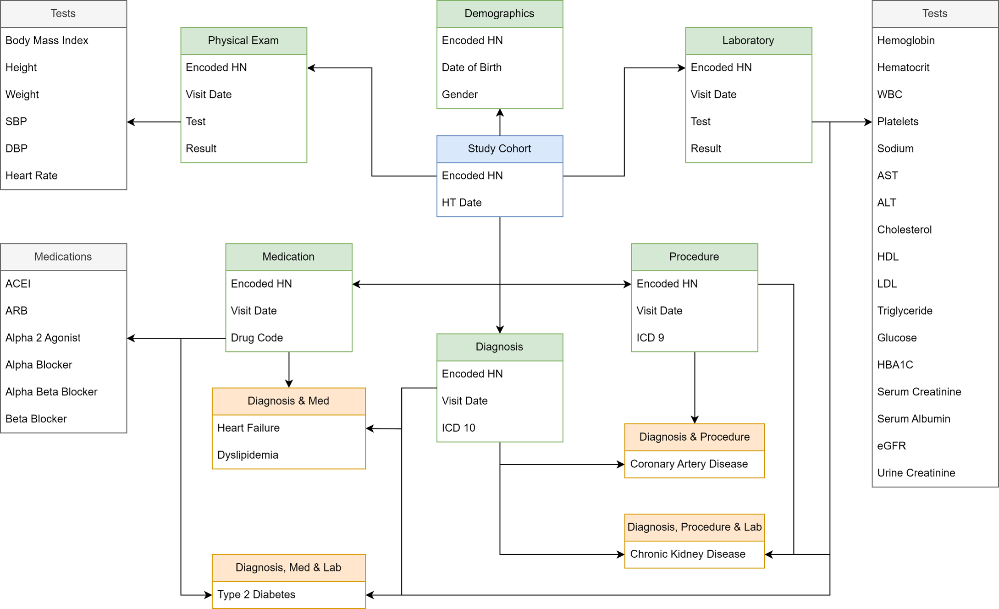
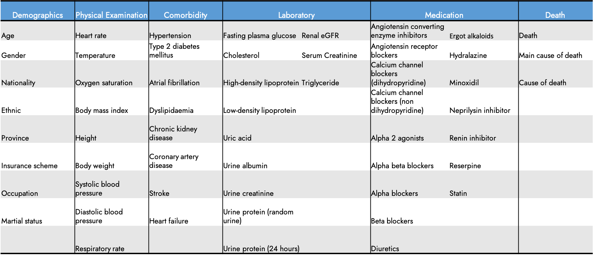

# Hypertension Data Warehouse

- **Author:** Htun Teza
- **Date:** 29 October 2026

## Contents
- [Hypertension Data Warehouse](#hypertension-data-warehouse-1)
  - [2010-2026/06 (16.5 years)](#2010-202606-165-years)
- [Hypertension cohort update](#hypertension-cohort-update)
  - [Data Warehouse Timeline](#data-warehouse-timeline)
  - [Update Summary](#update-summary)
- [Supplementary](#supplementary)
  - [Code](#code)
  - [Maplist](#maplist)
  - [Data Request](#data-request)
- [Usage](#usage)
  - [Publications](#publications)
  - [Conferences](#conferences)
  - [Competitions](#competitions)
---

## Hypertension Data Warehouse

### 2010-2026/06 (16.5 years)

Documentation on cohort identification procedure can be found [here](cohort_identification.md). The procedure has been peer-reviewed and published [here](https://doi.org/10.3389/fcvm.2023.1170010). From the 2010-2026/06 cohort, the cohort is rebuilt from a clean slate with the v2 criteria. The changes are listed at the top of the [cohort identification documentation](cohort_identification.md).

#### Data Flow

#### Entity Relationship Diagram

#### Variables

The complete list of variables can be found [here](https://docs.google.com/spreadsheets/u/1/d/1It8kMRhzvF-0NKo4eS0fkmqhYims3VlJ/edit?usp=sharing&ouid=109222607639327289784&rtpof=true&sd=true).

---

## Hypertension cohort update

### Data Warehouse Timeline

#### ETL timeline

With our latest data extraction (ETL) in June 2026,

- New case update to June 2026 (Bi-Annually)
- Follow up visits update to June 2026 (Quarterly).

The next update covers July to December 2026.

### Update Summary

#### Hypertension Cohort (16.5 years)

| Step | *n* |
|:---|--:|
| ICD-10 hypertension diagnosis (ICD only + both) | 260,315 |
| Medication only | 80,126 |
| Medication only, other indication found (excluded) | 5,397 |
| Inferred diagnosis | 74,729 |
| Hypertension patients | 335,044 |
| Age below 18 at index (excluded) | 6,687 |
| **Cohort 1 (adult)** | **328,357** |
| Hypertension evidence in 2005-2009 (prevalent, excluded) | 69,710 |
| **Cohort 2 (incident)** | **258,647** |

The number of patients by year can be found [here](cohort_identification.md#cohort-distribution).

### Supplementary

#### Code

The code used in the CEB data warehouse can be found in the code folder. It runs with Python 3.10 and the packages in [requirements.txt](requirements.txt).

|Type|Usage|Link|
|---|---|---|
|Settings|Period, dates, data folders and drug map for one update|[here](code/identification/update_config.py)|
|Baseline|Builds the 2010-2026/06 cohort in one run (start here for a new center)|[here](code/identification/cohort_clean_slate.py)|
|Stage 1|Loosely defined criteria: candidate list for a new period|[here](code/identification/cohort_loose.py)|
|Stage 2|Exactly defined criteria, full HT file and Cohort 1|[here](code/identification/cohort.py)|
|Stage 3|2005-2009 lookback and Cohort 2|[here](code/identification/cohort2.py)|
|Check|Read-only check of the data folders before stages 2 and 3|[here](code/preflight.py)|

The steps for an update can be found [here](cohort_identification.md#updating-the-cohort). The 2010-2024/12 notebooks are in the [Archive](code/Archive) folder.

> [!NOTE]  
> As of March 5, 2024, the data preprocessing pipeline is updated to use [Polars](https://github.com/pola-rs/polars) instead of Pandas, due to its multi-thread processing prowess. 

#### Maplist

The maplist of medication codes and other indications used for cohort identification can be found in the maplist folder.

| Type | Usage | Link |
| --- | --- | --- |
| Medication (Intrahospital Code) | Cohort identification | [here](maplist/cohort/medication_map.csv) |
| Other indications (ICD-10) | Exclusion criteria for medication-only patients | [here](maplist/cohort/other_indication_map.csv) |

The 2010-2024/12 map is in the [Archive](maplist/Archive) folder.

#### Data Request
More details regarding this and other cohorts can be found [here](https://www.rama.mahidol.ac.th/ceb/CEBdatawarehouse/Data/HT) at CEB-RAMA-MU. Data request can be made on the same webpage.

### Usage

#### Publications
- Teza, H., Anothaisintawee, T., Limpijankit, T., Tansawet, A., Boonmanunt, S., Pattanateepapon, A., McKay, G.J., Attia, J., Thakkinstian, A. (2026) Incidence and prognosis of apparent-treatment resistant hypertension: a multi-state analysis using real world evidence. *Clinical Hypertension, 32:e5*. https://doi.org/10.5646/ch.2026.32.e5

- Limpijankit, V., Sasiprapha, T., Teza, H., Pattanateepapon, A., Siriyotha, S., Boonmanunt, S., Attia, J., & Thakkinstian, A. (2025). Factors Associated With New-Onset Atrial Fibrillation in Thai Adults with Hypertension. *American Journal of Hypertension, 38(12), 1076–1087*. https://doi.org/10.1093/ajh/hpaf149

- Wabina, R. S., Looareesuwan, P., Sonsilphong, S., Teza, H., Ponthongmak, W., McKay, G., Attia, J., Pattanateepapon, A., Panitchote, A., & Thakkinstian, A. (2025). Uncertainty-aware approach for multiple imputation using conventional and machine learning models: a real-world data study. *Journal of Big Data, 12, 95*. https://doi.org/10.1186/s40537-025-01136-3

- Teza, H., Boonmanunt, S., Unwanatham, N., Thadanipon, K., Limpijankit, T., Pattanaprateep, O., Pattanateepapon, A., McKay, G. J., Attia, J., & Thakkinstian, A. (2023). Evaluation of transitions from early hypertension to hypertensive chronic kidney disease, coronary artery disease, stroke and mortality: a Thai real-world data cohort. *Frontiers in Cardiovascular Medicine, 10*. https://doi.org/10.3389/fcvm.2023.1170010

#### Conferences
- Teza, H., Pattanaprateep, O., Boonmanunt, S., Thadanipon, K., Limpijankit, T., Pattanateepapon, A., Unwanatham, N., & Thakkinstian, A. (2023). Hypertension and Its Associated Complications: A Thai Real-World Clinical Cohort. Poster session presented at the International Society for Pharmacoeconomics and Outcomes Research (ISPOR) 2023, Boston, MA.

#### Competitions
- Thailand Health AI Datathon 2023
