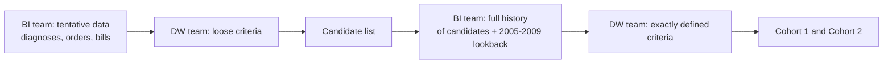
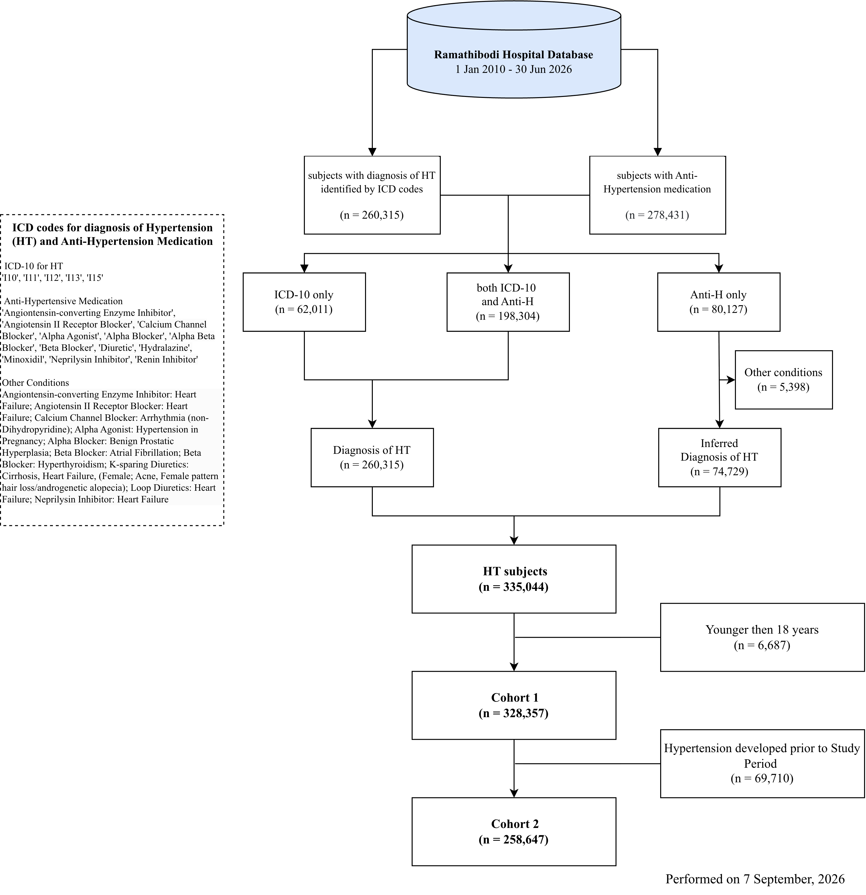

# Hypertension Cohort Identification

- **Author:** Htun Teza
- **Date:** 29 October 2026

> [!IMPORTANT]
> Please be aware that the information provided here is current as of the date of this documentation. However, it is subject to potential changes or updates in the future.

> [!NOTE]
> From the 2010-2026/06 cohort, the cohort is rebuilt from a clean slate with the **v2 criteria**. The main changes from the 2010-2024/12 cohort are:
> - A medication-only patient is excluded when **any** of their antihypertensive classes has a mapped other indication on or before the first medication date. Before, one class without an other indication was sufficient for inclusion.
> - Angiotensin receptor blockers (ARB) with heart failure are added to the other indications.
> - Each patient has an **index-day flag** (`icd`, `med` or `both`).
> - Cohort 2 is the **incident** cohort, defined with a 2005-2009 lookback. The complication-free cohort (old Cohort 2(b)) is not part of the data warehouse anymore.

## Contents

- [Hypertension Cohort Identification](#hypertension-cohort-identification)
  - [Contents](#contents)
  - [Data Source](#data-source)
  - [ETL Procedure](#etl-procedure)
  - [Loosely Defined Criteria](#loosely-defined-criteria)
  - [Exactly Defined Criteria](#exactly-defined-criteria)
  - [Final Cohort](#final-cohort)
  - [Cohort Distribution](#cohort-distribution)
  - [Updating the Cohort](#updating-the-cohort)

---

## Data Source

This cohort was retrieved from the Ramathibodi Hospital Information System covering **1 January 2010 to 30 June 2026**, processed as of 29 October 2026. A lookback extract covers **1 January 2005 to 31 December 2009**. The data warehouse was developed by the Data Science and Clinical Informatics Division, Department of Clinical Epidemiology and Biostatistics, Faculty of Medicine Ramathibodi Hospital, Mahidol University.

Diagnoses come from clinic and in-patient visits. Medication records come from the prescription orders (order and CPOE tables) and, for new cases and the lookback, from the drug bill. All dates are recorded at the day level.

Before matching, every diagnosis code is cast to text, changed to uppercase, and stripped of all characters except letters and digits. For example, `I50.1` becomes `I501`. Medication codes are **not** changed: they must match the drug map exactly, as delivered (`LOSL-T-` stays `LOSL-T-`). The hospital can give two codes that differ only in symbols, such as `FUR#-N-` and `FUR+-N-`, to different products, so stripping could merge them. Rows without a patient identifier are dropped.

---

## ETL Procedure

The goal of the procedure is to send the minimum of patient data to the data warehouse team (*hereafter the DW team*). The DW team works with the Data Health for Analysis Section (*informally the BI team*) of the Faculty of Medicine Ramathibodi Hospital. The procedure has two stages.

1. The BI team extracts all transactions that meet any loosely defined criterion. The DW team selects the candidate patients from these transactions.
2. The DW team sends the candidate list to the BI team. The BI team returns the complete medical history of the candidates, with the 2005-2009 lookback. The DW team applies the exactly defined criteria to this history.

For example, the loosely defined criterion "prescription of a beta blocker" brings in every patient billed for a beta blocker. The exactly defined criteria then check the full history of a medication-only patient for hyperthyroidism and atrial fibrillation before the first beta blocker.

---

## Loosely Defined Criteria

Patients were identified using two parallel criteria applied with an **OR condition**. Meeting either criterion was sufficient for inclusion.

### Diagnosis of Hypertension

Patients were identified from clinic and in-patient visit records using ICD-10-TM diagnostic codes. A code qualifies when it starts with one of the following prefixes:

| ICD-10-TM Code | Diagnosis Description |
|:---|:---|
| I10* | Essential (primary) hypertension |
| I11* | Hypertensive heart disease |
| I12* | Hypertensive renal disease |
| I13* | Hypertensive heart and renal disease |
| I15* | Secondary hypertension |

### Prescription of Antihypertensive Medications

Hypertension is often a secondary or underlying condition, so a diagnosis code alone can miss patients (Morley et al., [2014](https://doi.org/10.1371/journal.pone.0110900)). Antihypertensive prescriptions were therefore used as a second criterion.

At Ramathibodi Hospital, each trade product has an intra-institutional code (Rama drug code), which links to the Anatomical Therapeutic Chemical (ATC) classification. Each trade product is mapped to one or more cohort-specific subclasses. A combination pill maps to each of its components, which is common in line with the 2019 Thai Guidelines on the Treatment of Hypertension (Kunanon et al., [2021](https://doi.org/10.35755/jmedassocthai.2021.10.12199)).

| Drug Class | Subclass | Trade Products |
|:---|:---|--:|
| ACE inhibitor | ACEI | 44 |
| Angiotensin receptor blocker | ARB | 69 |
| Calcium channel blocker | CCB_DHP | 58 |
| Calcium channel blocker | CCB_nonDHP | 24 |
| Alpha-2 agonist | alpha2_agonist | 9 |
| Alpha blocker | alpha_blocker | 16 |
| Alpha-beta blocker | alpha_beta_blocker | 7 |
| Beta blocker | beta_blocker | 40 |
| Diuretic | Thiazide diuretics | 34 |
| Diuretic | Thiazide-like diuretics | 9 |
| Diuretic | Loop diuretics | 9 |
| Diuretic | K-sparing diuretics | 10 |
| Hydralazine | hydralazine | 11 |
| Minoxidil | minoxidil | 3 |
| Neprilysin inhibitor | neprilysin_inhibitor | 3 |
| Renin inhibitor | renin_inhibitor | 4 |

The mapping table of medication codes to subclasses can be found in the maplist folder [here](maplist/cohort/medication_map.csv).

> [!IMPORTANT]
> This criterion identifies patients by prescription only, with no exclusion rules applied at this stage. Exclusion rules are applied in the [Exactly Defined Criteria](#exactly-defined-criteria) section.

### Merging for Tentative Cohort

The two criteria put each patient into one of three groups:

1. Patients with ICD-10 hypertension codes only (*n* = 62,011)
2. Patients with both ICD-10 hypertension codes and antihypertensive prescriptions (*n* = 198,304)
3. Patients with antihypertensive prescriptions only (*n* = 80,126)

Groups 1 and 2 (*n* = 260,315) are considered to have a confirmed diagnosis of hypertension. Group 3 goes through the [Exactly Defined Criteria](#exactly-defined-criteria) before it can be an **inferred diagnosis** of hypertension.

---

## Exactly Defined Criteria

### Inferred Diagnosis of Hypertension

Antihypertensive medications are also prescribed for other conditions. For example, a beta blocker is prescribed for hyperthyroidism. Internal medicine specialists listed the common other indications for each subclass:

| Subclass | Other Indication | ICD-10 Prefixes | Sex |
|:---|:---|:---|:---|
| ACEI | Heart failure | I50, I501, I509 | All |
| ARB | Heart failure | I50, I501, I509 | All |
| neprilysin_inhibitor | Heart failure | I50, I501, I509 | All |
| Loop diuretics | Heart failure | I50, I501, I509 | All |
| K-sparing diuretics | Heart failure | I50, I501, I509 | All |
| K-sparing diuretics | Cirrhosis | K74 | All |
| K-sparing diuretics | Acne | L700, L701, L705, L709 | Female |
| K-sparing diuretics | Female pattern hair loss / androgenetic alopecia | L648, L649, L658 | Female |
| alpha_blocker | Benign prostatic hyperplasia | N40, N401, N403 | All |
| alpha2_agonist | Hypertension in pregnancy | O13, O139 | All |
| beta_blocker | Hyperthyroidism | E059 | All |
| beta_blocker | Atrial fibrillation | I48, I482, I489 | All |
| CCB_nonDHP | Arrhythmias | I471, I498, I499, R000, R002, R008 | All |

The mapping table can be found in the maplist folder [here](maplist/cohort/other_indication_map.csv). The ICD-10 values are prefixes: `I50` also matches `I500` and `I501`.

A patient in the medication-only group is **excluded** when all of these conditions are true:

1. One of their prescribed subclasses is in the table above.
2. A diagnosis in their full history starts with an ICD-10 prefix of that subclass.
3. That diagnosis is on or before their **first antihypertensive prescription**.
4. The sex condition of the rule is met. A `Female` rule needs a recorded female sex. An unknown sex does not meet a `Female` rule.

The time gap between the diagnosis and the prescription is not used. All other medication-only patients have an **inferred diagnosis of hypertension**.

#### Examples

| Patient | Prescriptions | Diagnosis history | Result |
|:---|:---|:---|:---|
| A | Beta blocker from 2015-03-01 | Hyperthyroidism (E059) on 2014-11-20 | Excluded: other indication before first prescription |
| B | Beta blocker from 2015-03-01 | Hyperthyroidism (E059) on 2016-02-10 | Inferred hypertension: other indication after first prescription |
| C | ACEI + alpha blocker from 2018-06-05 | Benign prostatic hyperplasia (N401) on 2017-01-15 | Excluded: one subclass (alpha blocker) has an earlier other indication |
| D | K-sparing diuretic from 2020-09-09, sex unknown | Acne (L700) on 2019-04-01 | Inferred hypertension: the acne rule needs a recorded female sex |

> [!NOTE]
> Patient C is a change from the 2010-2024/12 cohort. Before, one subclass without an other indication (here ACEI) made the patient an inferred diagnosis. Now, one subclass with an earlier other indication excludes the patient.

### Merging for Final Cohort

| Step | *n* |
|:---|--:|
| Medication-only patients | 80,126 |
| Other indication found (excluded) | 5,397 |
| Inferred diagnosis of hypertension | 74,729 |
| Confirmed diagnosis (groups 1 and 2) | 260,315 |
| **Hypertension patients (confirmed + inferred)** | **335,044** |

### Index Date and Flag

The **index date** is the first day on which any criterion is met: the earlier of the first hypertension diagnosis and the first antihypertensive prescription.

The **flag** shows which criteria are met on the index date itself:

| Flag | Meaning | *n* |
|:---|:---|--:|
| `icd` | Only a hypertension diagnosis on the index date | 112,558 |
| `med` | Only an antihypertensive prescription on the index date | 164,940 |
| `both` | A diagnosis and a prescription on the index date | 57,546 |

A diagnosis on the index date with a prescription one week later is `icd`. The flag is set on the index date only.

### Data Format

This table is the primary table for cohort curation (full HT file). It has one row per hypertension patient, adults and children, and it grows with each update.

| Column | Description |
|:---|:---|
| `ENC_HN` | Patient identifier (hashed) |
| `ICD_DATE` | First hypertension diagnosis date, or blank |
| `ICD` | Hypertension diagnosis codes, for example `['I10']`, or blank |
| `MED_DATE` | First antihypertensive prescription date, or blank |
| `MED` | Antihypertensive medication codes as delivered, for example `['AMLP1T-']`, or blank |
| `D001KEY` | Index date |
| `flag` | `icd`, `med` or `both` |
| `index_date_all` | Earliest hypertension evidence including the 2005-2009 lookback (`_index_all` copy only) |

Each row has at least one of `ICD` or `MED`. Diagnosis codes are normalized. Medication codes are kept as delivered. Each list is sorted and unique. A missing value is blank in the CSV and null in the parquet file.

#### Example Data Table

| HN | ICD_DATE | ICD | MED_DATE | MED | D001KEY | flag | index_date_all |
|-|-|-|-|-|-|-|-|
| 001 | 2015-03-02 | ['I10'] | 2015-03-02 | ['AMLP1T-'] | 2015-03-02 | both | 2015-03-02 |
| 002 | 2018-07-11 | ['I10'] | — | — | 2018-07-11 | icd | 2018-07-11 |
| 003 | — | — | 2012-05-20 | ['LOSL-T-'] | 2012-05-20 | med | 2012-05-20 |
| 004 | 2020-01-15 | ['I10', 'I132'] | 2019-11-04 | ['AMLP1T-', 'LOSL-T-'] | 2019-11-04 | med | 2019-11-04 |
| 005 | 2011-02-10 | ['I10'] | — | — | 2011-02-10 | icd | 2007-06-01 |

- HN 003 is an inferred diagnosis: medication only, with no earlier other indication.
- HN 004 had a prescription before the diagnosis, so the index date is the prescription date and the flag is `med`.
- HN 005 had hypertension evidence in the 2005-2009 lookback. HN 005 is in Cohort 1 but not in Cohort 2.

---

## Final Cohort

All hypertension patients, confirmed and inferred, are included in the **CEB Data Warehouse – Hypertension Theme**. The study period is **1 January 2010 to 30 June 2026**.

### Cohort 1 (Adult)

Only patients aged **18 years or older** on the index date are included. A patient without a date of birth is excluded.

| Step | *n* |
|:---|--:|
| Hypertension patients | 335,044 |
| Missing date of birth (excluded) | 0 |
| Age below 18 at index (excluded) | 6,687 |
| **Cohort 1** | **328,357** |

### Cohort 2 (Incident)

Cohort 1 is a prevalent cohort: a patient can have had hypertension before 2010. Cohort 2 removes every Cohort 1 patient with hypertension evidence in the 2005-2009 lookback:

1. A diagnosis with ICD-10 prefix I10, I11, I12, I13 or I15.
2. A bill for a mapped antihypertensive medication.

| Step | *n* |
|:---|--:|
| Cohort 1 | 328,357 |
| Lookback hypertension diagnosis | 52,891 |
| Lookback antihypertensive bill | 61,752 |
| Any lookback evidence (prevalent, excluded) | 69,710 |
| **Cohort 2** | **258,647** |

The other-indication exclusion is **not** applied in the lookback. A billed antihypertensive before 2010 counts as earlier hypertension. For an incident cohort, a false exclusion costs less than a prevalent case that stays in.

> [!NOTE]
> - Before 2010, no order table exists, so the lookback uses the bill only.
> - The lookback diagnosis files keep the ICD-10 code in two columns (`D035KEY` or `D108KEY`). Both columns are read.
> - The lookback is five years. A patient diagnosed before 2005 who had no visit in 2005-2009 stays in Cohort 2.

Dataflow diagram:

---

## Cohort Distribution

> [!NOTE]
> The following table is based on data identified up to 30 June 2026, and may not reflect any subsequent data additions or corrections.

Number of patients by year of index date:

| Year | Cohort 1 | Cohort 2 |
|:---|--:|--:|
| 2010 | 69,750 | 15,319 |
| 2011 | 21,427 | 17,272 |
| 2012 | 21,057 | 18,613 |
| 2013 | 20,145 | 18,472 |
| 2014 | 18,134 | 16,934 |
| 2015 | 17,522 | 16,565 |
| 2016 | 17,511 | 16,687 |
| 2017 | 17,036 | 16,331 |
| 2018 | 16,972 | 16,341 |
| 2019 | 17,174 | 16,673 |
| 2020 | 12,883 | 12,451 |
| 2021 | 12,828 | 12,492 |
| 2022 | 15,562 | 15,152 |
| 2023 | 15,118 | 14,808 |
| 2024 | 14,300 | 14,010 |
| 2025 | 13,906 | 13,604 |
| 2026 (to June) | 7,032 | 6,923 |
| **Total** | **328,357** | **258,647** |

Most Cohort 1 patients with a 2010 index date are prevalent cases. This is why the 2010 count drops from 69,750 to 15,319 in Cohort 2.

---

## Updating the Cohort

The baseline (2010-2026/06) was built in one run by [`cohort_clean_slate.py`](code/identification/cohort_clean_slate.py). A new center can use this script to build its own baseline. After the baseline, each update adds one six-month period in three stages.

| Stage | Script | Input | Report |
|:---|:---|:---|:---|
| Settings | [`update_config.py`](code/identification/update_config.py) | Edit the lines marked `EDIT` | — |
| Check | [`preflight.py`](code/preflight.py) `ident` | Delivery folders | `preflight_ident.txt` |
| 1. Loose | [`cohort_loose.py`](code/identification/cohort_loose.py) | Tentative data | `loose/loose_output.txt` |
| 2. Strict | [`cohort.py`](code/identification/cohort.py) | Full history of candidates | `strict/strict_output.txt` |
| 3. Incident | [`cohort2.py`](code/identification/cohort2.py) | 2005-2009 lookback | `index/cohort2_output.txt` |

1. Edit `code/identification/update_config.py`: the period, the dates, and the data folders.
2. Run `python code/identification/cohort_loose.py`.
3. Send `data/identification/<PERIOD>/loose/loose_new_candidates.parquet` to the BI team.
4. When the full history arrives, run `python code/preflight.py ident`.
5. Run `python code/identification/cohort.py`.
6. Run `python code/identification/cohort2.py`.

Patients already in the previous full file are not added again. The criteria are the same in the baseline and in every update. Outputs go to `data/identification/<PERIOD>/`, which is not part of this repository.

> [!IMPORTANT]
> Before you accept Cohort 2, check the "Lookback data availability" section of `cohort2_output.txt`. All five years (2005-2009) must be present for diagnosis and bill. A missing lookback year makes Cohort 2 too large.
